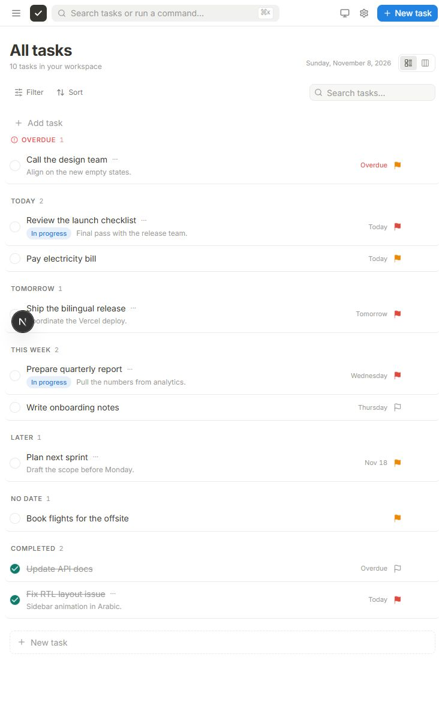
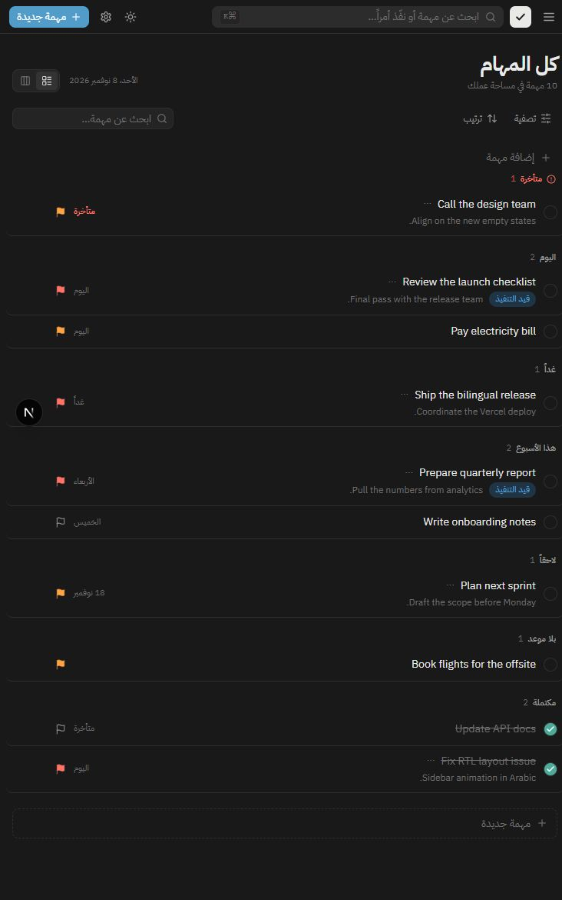
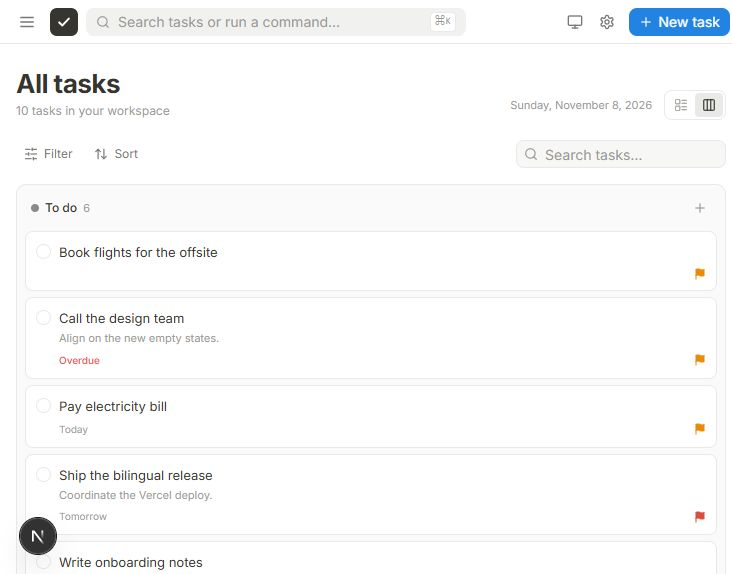

# TaskFlow — Bilingual Multi-User To-Do App

A production-ready **Python (FastAPI) + Next.js** portfolio project: multi-user Task Management API with a fantastic, responsive, fully bilingual (EN/AR + RTL) frontend. Deployed as **one Vercel project** (Vercel Services) with **Supabase Postgres** (production) / **SQLite** (development).







## Features

- **Authentication:** Register / Login (Email + Password) with bcrypt hashing + JWT (Bearer)
- **Data Isolation:** Every task query scoped by `user_id` from token — foreign tasks return **404**, never leak existence
- **Tasks:** Create / Read / Update (PATCH) / Delete — status `todo | in_progress | done`, priority `low | medium | high`, due_date (Date, past allowed), `is_overdue` derived
- **Search / Filter / Sort / Pagination:** `?q=` (ILIKE), `status`, `priority`, `overdue`, `sort` (created_at/due_date/priority), `skip`/`limit`
- **Bilingual UI (EN / AR + RTL):** `Accept-Language` Header > `users.language` setting > default `en`. Frontend flips `dir="rtl"` instantly, Settings → Language persists after logout.
- **Frontend Design System:** Tailwind v4, Dark/Light/System theme, Skeleton loading, Empty states, Optimistic updates, Undo delete, Keyboard shortcuts (`/` search, `N` new task)
- **Today Queue:** `GET /api/tasks/today` returns tasks due today + tomorrow + overdue (sorted by due_date) — used for sidebar badges & overdue toast
- **22 Passing Tests** — auth, ownership isolation, filtering, pagination, i18n, edge cases (empty title, invalid enums, expired tokens, overdue logic)

## Architecture

```
User ─HTTPS─▶ One Vercel Project (one domain, one deployment)
               ├── /        → Next.js (frontend/)
               └── /api/*   → FastAPI (backend/) ──▶ Supabase Postgres
                                   └─ Local dev: SQLite
```

- The browser always calls `/api` on the **same origin**. In production, Vercel routes `/api/*` to FastAPI. In local dev, the dev server rewrites `/api/*` to `http://127.0.0.1:8001/api/*` (port 8000 is reserved in this repo's dev environment, so FastAPI runs on 8001; `NEXT_PUBLIC_API_URL` may point directly at the backend for direct calls).
- No `NEXT_PUBLIC_API_URL` and no browser CORS are needed for the single-app deployment.
- Database tables are created on first request via FastAPI lifespan, not at build/import time.

See [`docs/architecture.md`](docs/architecture.md) for ER diagram, sequence, and deployment diagram.

## Quick Start

Run FastAPI and Next.js in two terminals.

### Backend
```bash
# Backend (run from the repo root; uvicorn reads backend/app because
# `app` is a package inside `backend/` — use --app-dir backend if needed)
cd backend
python -m venv .venv
.venv\Scripts\Activate.ps1        # Windows
pip install -r requirements-dev.txt
uvicorn app.main:app --host 127.0.0.1 --port 8001 --reload  # http://127.0.0.1:8001/api/docs
```

### Frontend
```bash
cd frontend
npm install --legacy-peer-deps
npm run dev -- --webpack   # Turbopack not supported on Windows — use webpack
# Open http://localhost:3000
```

### Tests
```bash
cd backend
pytest tests/ -v
# 22 passed
```

## Environment Variables

| Variable | Where | Example |
|---|---|---|
| `DATABASE_URL` | Backend (Vercel project) | `postgresql://...` (Supabase pooler URL) |
| `SECRET_KEY` | Backend (Vercel project) | long random string |

> Never commit `.env`. The frontend does not need `NEXT_PUBLIC_API_URL` in the single-app deployment.

## Deployment (One Vercel Project + Supabase)

1. Create a **Supabase** project → copy the connection string (session pooler on `:5432`, `sslmode=require`).
2. Push the repo to GitHub.
3. Vercel → New Project → Import repo → **Root Directory = repository root** → **Framework Preset = Services**.
4. Set env vars on the single project: `DATABASE_URL`, `SECRET_KEY`, `DEBUG=false`.
5. Deploy → smoke test `/` and `/api/health` + register/login flow.

See [`docs/deployment.md`](docs/deployment.md) for the full step-by-step.

## Project Structure

```
project-01/
├── vercel.json           # Vercel Services: api + web, one deployment
├── .vercelignore
├── backend/
│   ├── app/              # FastAPI (core, db, schemas, crud, routers, locales)
│   ├── tests/
│   └── requirements.txt
├── frontend/
│   ├── app/              # Next.js App Router (login, register, dashboard, settings)
│   ├── components/       # ui/, tasks/, layout/
│   ├── lib/              # api.ts (calls /api), store.tsx (lang/theme)
│   └── messages/         # en.json, ar.json
└── docs/
    ├── architecture.md
    └── deployment.md
```

## Security Checklist

- [x] bcrypt hashing only, never plain text
- [x] Env vars only for secrets
- [x] Email normalized lowercase + unique
- [x] Every query scoped by token `sub`
- [x] Pydantic validation mirrors frontend Zod
- [x] ON DELETE CASCADE (no orphaned tasks)
- [x] Foreign tasks → 404 (no existence leak)

## Lessons Learned

- Validation ≠ Normalization (strip + lowercasing prevents duplicate accounts)
- `jose` requires JWT `sub` as string — otherwise `Subject must be a string`
- Serverless ephemerality: SQLite dies on Vercel → Supabase/Neon Postgres persists
- Presentation vs Storage: system messages translate at the edge, content stays free text
- Ownership isolation is a security feature, not a filter
- One-origin `/api` routing removes CORS and API-URL config for a full-stack deploy

## License

MIT
