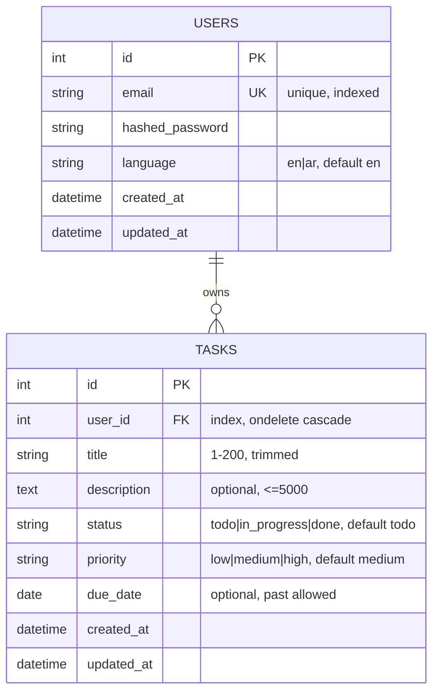
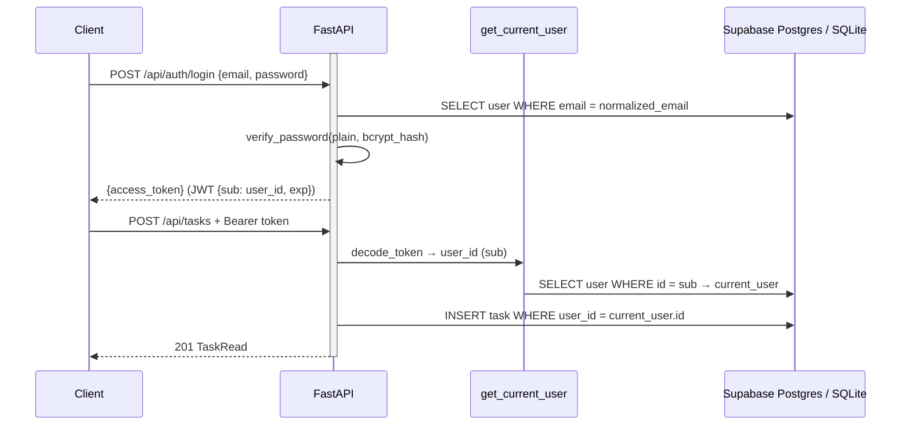
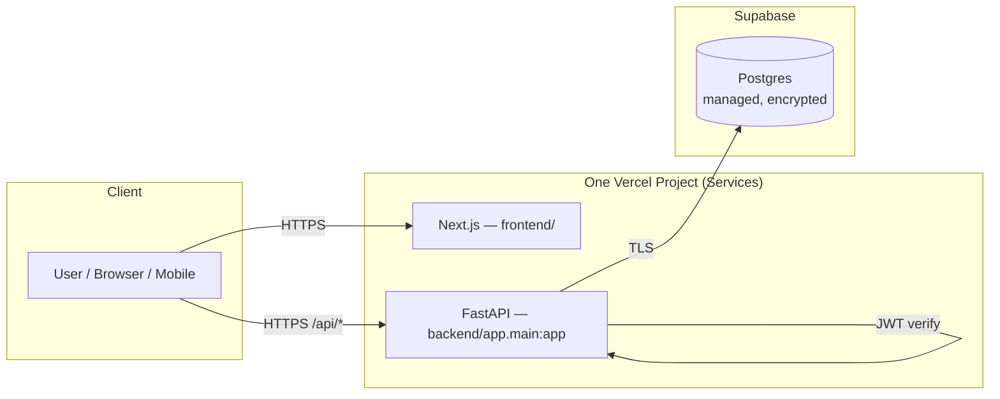

# System Architecture

## ER Diagram (Users ↔ Tasks)

## Relationship Notes

- **One-to-Many**: One `User` owns many `Task`s. Each `Task` has exactly one `User`.
- **Foreign Key**: `tasks.user_id → users.id` with `ON DELETE CASCADE` — deleting a user deletes their tasks (no orphaned tasks).
- **Unique**: `users.email` is unique and normalized to lowercase.
- **Derived data**: `is_overdue` is **never stored** — computed on read as `due_date < today AND status != done`.
- **Enum columns**: stored as `String` with application-level strict validation (`pattern` regex), portable between SQLite and Postgres.

## Request Flow

## Design Decisions (D1–D11)

| # | Decision | Reason |
|---|---|---|
| D1 | `status` and `priority` as strict enums | Prevent corrupt values like `"finished"`; ensures filter correctness |
| D2 | `priority` is ordered (`low < medium < high`) | Used in sorting, not free text |
| D3 | Defaults `todo` + `medium` | Lowers friction for daily use |
| D4 | `due_date` = `Date` only | Avoids Timezone complexity in MVP; upgrade path clear |
| D5 | Past `due_date` allowed | Useful for backlog; overdue handled by filter, not a create-time gate |
| D6 | `is_overdue` never stored | Derived data must not fight stored state |
| D7 | Every task query scoped by `user_id` from token | Data isolation is a security boundary |
| D8 | Passwords bcrypt-hashed only | Even a DB leak cannot recover plain passwords |
| D9 | `users.language` + translation at presentation edge | Bilingual without duplicate columns in tasks |
| D10 | SQLite (dev) → Supabase Postgres (prod) via `DATABASE_URL` | Fast local iteration + durable production storage |
| D11 | Hard delete in MVP | Soft delete deferred to a later upgrade exercise |
| D12 | One Vercel project (Services): `/` → Next.js, `/api/*` → FastAPI | Single domain + single deployment; browser calls same-origin `/api`, no `NEXT_PUBLIC_API_URL` or browser CORS |

## Deployment Diagram

### Why serverless + Supabase?

- **Vercel Functions** have ephemeral filesystem — SQLite files disappear between invocations ("hotel room" problem).
- **Supabase Postgres** persists data on managed storage with encryption and connection pooling.
- Switching environments = changing `DATABASE_URL` only (SQLAlchemy abstracts the driver; psycopg 3 handles `postgresql://` → `postgresql+psycopg://`).

## API Surface

| Method | Path | Purpose |
|---|---|---|
| GET | `/api/health` | Liveness check |
| POST | `/api/auth/register` | Create user |
| POST | `/api/auth/login` | Issue JWT |
| GET | `/api/users/me` | Profile |
| PATCH | `/api/users/me` | Update language |
| POST | `/api/tasks` | Create task |
| GET | `/api/tasks` | List + filters |
| GET | `/api/tasks/counts` | Sidebar counters |
| GET | `/api/tasks/today` | Today queue |
| GET | `/api/tasks/{id}` | Detail |
| PATCH | `/api/tasks/{id}` | Partial update |
| DELETE | `/api/tasks/{id}` | Delete |
| GET | `/api/docs` | FastAPI Swagger UI |
